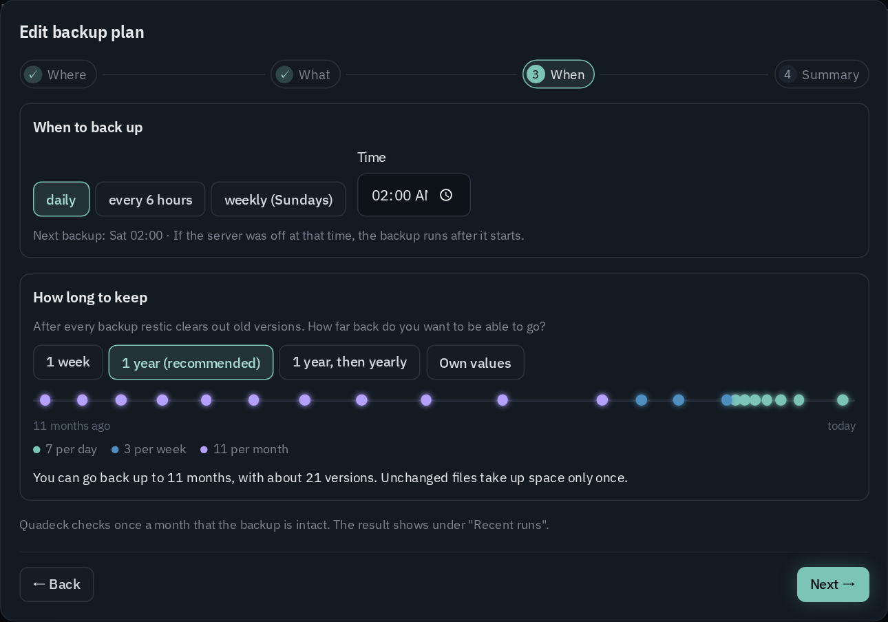
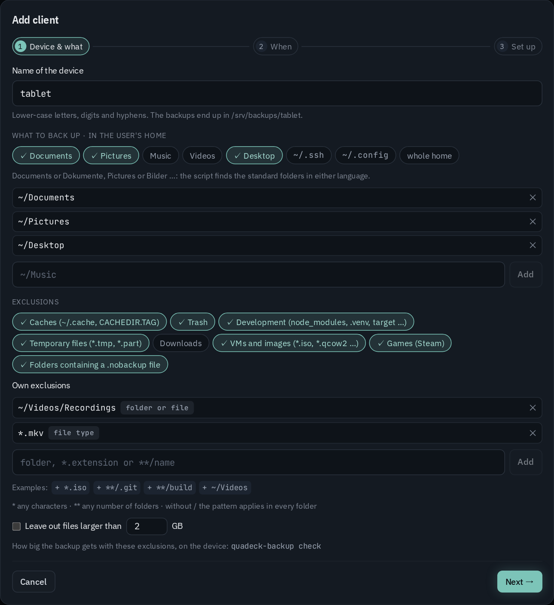

# Backups

The **Backups** page (in the menu under Storage) backs up the server with
[restic](https://restic.net): encrypted, deduplicated, on a schedule, with snapshots you can browse
and restore from the page. Without restic the page offers to install it.

## Setting up

**Set up backup …** opens a wizard in four steps. **Next** only goes on when the step is complete
(a target, the credentials it needs, at least one folder); the step bar at the top jumps back.
**Edit plan …** opens the same wizard on its summary, with a **change** link per row.

1. **Where**: a file system (a second disk, a USB disk, a NAS mount), SFTP (a NAS or another
   server), S3 or compatible (MinIO, Wasabi …), Backblaze B2 or a restic REST server.
   - For a file system, a folder browser below the field walks the server's whole file system
     (folder names only, read by the root helper). It shows the disk the folder is on with its free
     space, and warns when that is the same disk as folders that are backed up.
   - The parent folder must exist; the last part is created. When the disk is not mounted, nothing
     is created on the system disk by mistake. The target must not lie inside a folder that is
     backed up, nor the other way round.
   - SFTP runs as root: root needs an SSH key without passphrase for the target (`ssh-copy-id` as
     root).
   - Credentials (`AWS_ACCESS_KEY_ID`/`AWS_SECRET_ACCESS_KEY`, `B2_ACCOUNT_ID`/`B2_ACCOUNT_KEY`,
     `RESTIC_REST_USERNAME`/`RESTIC_REST_PASSWORD`) are stored in a file only root can read. They
     never travel back to the browser; an empty field keeps the stored value.
2. **What**, with the exclusions:
   - Suggested from your Quadlets, grouped by container (folded, with "2 of 3 folders"): every
     container's folders (`Volume=/host/path:…`) and named volumes (`Volume=name:…`,
     `Volume=x.volume:…`), plus `/etc` under *System*. A group's checkbox takes all its folders.
   - Not preselected, with the reason next to them: folders mounted read-only (a media library),
     very broad folders (`/mnt`, `/srv`, a whole home), folders that hold folders of other
     containers, and media or downloads (`movies`, `tvshows`, `music`, `Downloads` …). Sockets,
     `/run`, `/dev` and system files handed in read-only (`/etc/localtime`) are left out.
   - Named volumes are resolved to their folder on the host (`podman volume inspect`) at every run.
   - **+ Add folder …** adds any folder of the server through the folder browser (hidden folders
     on request); they show under *Own folders*.
   - Exclusions: caches (folders marked with `CACHEDIR.TAG`), temporary files, logs, folders
     containing a `.nobackup` file; what an app rebuilds by itself, found from the Quadlets (the
     Jellyfin cache with its transcodes, Immich thumbnails and transcoded videos); **Exclude a
     folder …** through the browser; your own restic patterns; an optional size limit per file.
   - **Measure size** runs `du` on the selected folders and shows the size per group and how much
     the left-out folders save.
3. **When**, in two separate boxes:
   - **When to back up**: daily, every 6 hours or weekly (Sundays), at a time you choose, with the
     next run. A run missed because the server was off follows after the start (`Persistent=true`).
   - **How long to keep**: after every backup `restic forget --prune` clears out old snapshots.
     The choice is how far back you can go: *1 week* (7 daily), *1 year* (7 daily, 4 weekly,
     12 monthly, the default), *1 year, then yearly* (plus 10 yearly) or *own values*. A timeline
     shows which snapshots stay, with how far back and about how many.
   - The repository check (`restic check`, reading 5 % of the data) runs monthly by itself; its
     result shows under *Recent runs*.
4. **Summary**: everything at a glance. A new backup can start right away (*Start the first backup
   right away*, on by default).



Containers are not stopped during the backup any more. A plan from before that still lists units to
stop shows them on the page; saving it in the wizard clears them.

**Set up** creates the repository (`restic init`) when there is none yet at the target. An existing
repository is opened, never replaced: if it cannot be opened (for example a wrong password), saving
stops with restic's message.

## The repository password

Quadeck generates the password when the backup is first set up and stores it readable only for
root. **Show password …** displays it after the unlock, to copy or download. Keep it somewhere
other than this server, in a password manager or on paper. With the password and the target, the
backups open with restic on any computer. Without it, they cannot be read at all. Until you confirm
**Stored safely**, the page reminds you.

To read the repository by hand on another machine:

```bash
export RESTIC_REPOSITORY=/mnt/backup/restic   # or sftp:…, s3:…, b2:…, rest:…
restic snapshots          # asks for the password
restic restore latest --target /tmp/restore --include /srv/immich/upload
```

## Status and runs

- **Status**: the last backup with its result, duration and new data; the next run; the repository
  size and snapshot count; the target with its free space.
- **Back up now** and **Check repository** start the systemd units right away.
- **Recent runs**: a bar per backup for the new data, each run with its duration, and the messages
  of a run that finished with warnings (files that could not be read).
- **Snapshots**: every snapshot with the number of files, new and total data. The list is read
  from the repository after every run; **Read again** reads it now.

## Browsing and restoring

**Browse** opens a snapshot like a file browser:

- Each entry is compared with the server today: **deleted**, **changed** or unchanged.
- **Download** gets a single file. A folder comes as a zip (`restic dump`). Downloads need the
  unlock, because a backup holds files only root may read.
- **Restore …** runs as a job with live output (`restic restore`):
  - **Into a new folder** (default `/srv/restore/<date>`): the files land there with their full
    path.
  - **In place**: overwrites today's files with the snapshot's. It asks first, and stops the
    containers of the plan and those whose folders are restored, starting them again afterwards.

## How it runs

- Two systemd units in `/etc/systemd/system`, visible on the units page:
  - `quadeck-backup.service` with its `.timer` runs `quadeck backup run`.
  - `quadeck-backup-check.service` with its `.timer` runs `quadeck backup check`.
  - The timers are `Persistent=true`: a run missed while the server was off is caught up after
    booting.
- `quadeck backup run`:
  1. stops the units of an older plan that still lists some,
  2. runs `restic backup` with the exclusions, tagged `quadeck`,
  3. starts those units again,
  4. applies the retention (`restic forget --prune --tag quadeck`),
  5. records the run and reads the snapshot list.

  Its output is in the unit's journal.
- **Switch backups off** removes the schedule. The repository with all snapshots, the password and
  the credentials stay, so switching on again continues with the same repository.
- Files: `/var/lib/quadeck-helper/backup/` (mode 700) holds `plan.json`, `password`, `env`
  (credentials), the generated exclude file, the run records and restic's cache. Set
  `QUADECK_BACKUP_DIR` to move it.

## From the command line (and for agents)

`quadeck backup …` does on the server, as root, what the page does. Every command takes `--json`,
so a script or an AI agent can look around, suggest a plan and set it up; `quadeck backup guide`
prints the steps for an agent. `quadeck backup skill install` writes them as a skill for Claude Code
(`~/.claude/skills/quadeck-server-backup/SKILL.md`, no root needed): asked about backups on the
server, Claude Code then knows the commands by itself.

```bash
sudo quadeck backup status                 # plan, last runs, next run, repository
sudo quadeck backup suggest                # folders from the Quadlets, with the reason when not suggested
sudo quadeck backup dirs /srv              # sub-folders, the disk and its free space
sudo quadeck backup sizes /srv/app --exclude /srv/app/cache
sudo quadeck backup plan draft > plan.json # a new plan from the suggestions, to edit
sudo quadeck backup plan set -f plan.json --dry-run   # what changes, sizes, warnings; saves nothing
sudo quadeck backup plan set -f plan.json  # save: opens or creates the repository, writes the timer
sudo quadeck backup run                    # back up now
sudo quadeck backup clients                # the clients: plan, online, waiting
sudo quadeck backup client plan set laptop -f laptop.json [--dry-run]
```

- The plan is the same JSON the page stores, checked the same way; `plan show --json` prints the
  current one. A plan without `passwordSaved` keeps the current confirmation.
- Credentials of S3, B2 or REST targets come from a file with `--secrets <file>` (`KEY=value`
  lines), never from the command line; left out, the stored ones stay.
- `--dry-run` lists every change (`+` added, `-` removed, `~` changed), the size of the folders with
  what the excluded folders take, the target's disk, and warns when the target is on the same disk
  as the data.
- Exit codes: 0 done, 1 failed, 2 a usage error or a plan that does not pass the checks. With
  `--json` an error comes as `{ "error": "…" }`.
- `clients` shows per client whether it is connected and online, whether it has a plan and runs
  its current version, and tasks still waiting for it. `client plan set` stores a client's plan
  as changed with the CLI; the computer picks it up within about 10 minutes.

## Backup target for clients

The **Clients** tab turns the server into the backup target for the other computers at home: one
[restic rest-server](https://github.com/restic/rest-server) for all of them, each with its own
repository and its own access.

**Set up backup target …** asks for:

- **Data folder**: one folder per client below it. The parent folder must exist. The same folder
  browser as for the server's target walks the file system below the field, with the disk and its
  free space.
- **Port**: the rest-server is published on it.
- **Address for the clients**: what the computers use, e.g. `http://nas.lan:8000`. For HTTPS, add a
  domain in the [reverse proxy](network.md#reverse-proxy) pointing at `localhost:<port>` and enter
  it here.
- **Append only**: optional. Clients can add snapshots but not delete them, so an infected computer
  cannot destroy its backups. Clients then cannot remove old snapshots either.

It writes `quadeck-rest-server.container` (image `restic/rest-server`, `--private-repos`) through the
Quadlet editor's checks and history, and starts it.

A computer is **connected first and planned afterwards**: **+ Add client** asks only for its name,
then shows the command for the computer. What and when it backs up is set once it is connected:
here with **Set plan**, by an AI agent on the computer, or with the CLI on the server.

### Connecting a computer

The name: lower-case letters, digits and hyphens; the backups land in `<data folder>/<name>`.
**Create** saves the client and shows a one-liner for it, with three numbered steps (open a
terminal as the normal user, paste the command, choose the repository password):

```bash
curl -fsSL http://nas.lan:8484/api/backup/script/<setup link> | sh
```

- The link is good for **30 minutes** or **until the computer has connected**, whichever comes
  first. It needs no login: the link itself (192 random bits) is the authorisation.
- It can be fetched more than once until then – reviewed first, or the script run again after it
  stopped half-way (restic missing, server not reachable). Every fetch carries the same access and
  token, so an earlier half-done install keeps working.
- An expired link, or one whose computer is set up, answers with a message to create a new one
  (**Show command** in the row menu).
- **Review first** shows the same as download, check, run.

While the computer has not run the command yet, the dialog says it is waiting and notices within
seconds when it has; then **Set plan** opens the plan.

The script is POSIX `sh` and is run as the normal user, not as root. It:

1. checks that restic and systemd are there (and names the install command if restic is
   missing: `brew install restic` where Homebrew is, `rpm-ostree install restic` on an atomic
   system, else the package manager), and remembers where restic is (the user units do not get
   the login shell's `PATH`),
2. writes `~/.config/quadeck-backup/` (mode 700): the access (renewed with every link, so only
   the newest link's access works), the folders and the exclusions of the plan if there is one,
3. asks **once** for the repository password and keeps it in `~/.config/quadeck-backup/password`.
   It encrypts the backups and never leaves the computer. On a later run the script only checks
   that it still opens the repository,
4. connects to the rest-server (says so, and gives up after 30 seconds with the reason when it
   cannot reach it) and creates the repository on the first run (`restic init`),
5. installs `~/.local/bin/quadeck-backup` and the user units: `quadeck-backup.service` and
   `.timer` for the backups on the plan's schedule (`Persistent=true`: a run missed while the
   computer was off is caught up; off while there is no plan or the plan is paused), and
   `quadeck-backup-agent.service` and `.timer`, which ask Quadeck every 10 minutes (see below),
6. tells Quadeck that it is set up (this ends the link and marks the plan as arrived) and sends
   the folder list in the background.

Without a plan it ends with *connected – no backup plan yet*: nothing is backed up until a plan
comes. The script hints at `sudo loginctl enable-linger <user>` when the user's timers only run
while the user is logged in.

### The client's plan

A row without a plan says **Connected – no plan yet**, with:

- **Set plan**: the plan editor, starting from the recommended plan,
- **Use the recommended plan**: Documents and Pictures (named in the UI's language; the script
  finds either name) weekly, with the default exclusions and retention, in one click,
- the commands for an agent: `quadeck backup client plan set <name> -f plan.json` on the server,
  `quadeck-backup plan set` on the computer.

**Edit …** in the row menu opens the same editor with two tabs:

- **What**:
  - the standard folders as a quick choice (Documents, Pictures, Music, Videos, Desktop,
    `~/.ssh`, `~/.config`, the whole home) and any other folder (`~` is the home of the user who
    runs the script, or an absolute path). The script finds a standard folder under either
    language (`~/Dokumente` or `~/Documents`) or where `xdg-user-dirs` put it.
  - **Choose a folder …** browses the computer's folders, with their size and what they are
    (caches, development folders, Steam, a git project …). The computer sends this list itself
    (see *How the client talks to Quadeck*); until it has, the editor says how to get it.
  - What the list finds inside the chosen folders that a preset would leave out is shown above
    the exclusions, with its size and **Leave out** to switch the preset on.
  - Exclusions: presets (caches, trash, development folders like `node_modules`, `.venv`,
    `target` …, temporary files, downloads, VM images, Steam, folders with `.nobackup`) and own
    rules as a list, each labelled as folder or file, file type (`*.mkv`) or pattern (`**/build`),
    with examples to add in one click. A rule that would leave out everything (`/`, `~`, `*` …) is
    refused. Plus an optional size limit per file.
- **When**: hourly, every 6 hours, daily or weekly; how long to keep with the same presets and
  timeline as the server backup (1 week, 1 year, 1 year then yearly, own values); a warning after
  N days without a backup; **active** (off pauses the backup timer on the client).



**Save** stores the plan with a new version. The computer takes it within about 10 minutes (its
agent timer) or, at the latest, before its next backup; until then the row says **waiting**, then
**arrived ✓**. Who changed the plan last and when is shown below: in Quadeck, with the CLI, or on
the device. Running the command again is never needed for a new plan.

On the client:

| | |
|---|---|
| `quadeck-backup now` | back up right now |
| `quadeck-backup check [--files]` | dry run: the size without and with the exclusions, how much they leave out and what the next run would upload; `--files` lists the files |
| `quadeck-backup status` | the last backups and the next run |
| `quadeck-backup scan [--json]` | send the folder list to Quadeck now (also once a day after a backup) |
| `quadeck-backup sync` | fetch new settings from Quadeck now (also before every backup) |
| `quadeck-backup poll` | ask Quadeck for a new plan or a task (what `quadeck-backup-agent.timer` runs every 10 minutes) |
| `quadeck-backup plan show` / `plan set -f <plan.json>` | the plan as JSON (`plan` is null without one) / set a new one from the computer |
| `quadeck-backup check --plan <draft.json> [--json]` | the dry run for a draft plan, without saving it |
| `quadeck-backup guide [--skill]` | the steps for an AI agent that sets up this backup with you |
| `quadeck-backup skill install` | the same as a skill for Claude Code (`~/.claude/skills/quadeck-backup`) |
| `quadeck-backup mount [dir]` | the backups as folders under `~/Backup` (needs FUSE) |
| `quadeck-backup restore <path> [dir]` | restore from the latest backup |
| `quadeck-backup uninstall` | remove both timers and the command (settings and password stay) |

On an append-only target the clients skip `forget`; old snapshots stay.

### How the client talks to Quadeck

Every setup link carries a token for this computer, renewed with every new link (Quadeck keeps
only its SHA-256, in the helper). With it, `quadeck-backup` talks to
`<Quadeck>/api/backup/agent/<name>`, the address the browser used when the command was created.
Quadeck never sends commands: only data, which the client checks line by line.

- **Poll**: every 10 minutes (randomised by up to 2 minutes, caught up after the computer was
  off) `quadeck-backup-agent.timer` asks for the plan's version and the tasks waiting for it. A
  new version is fetched right away; the tasks are handed out once: **back up now** starts
  `quadeck-backup.service` without waiting for it, **refresh folder list** sends a new one. Any
  other word is ignored. The backup timer does not depend on it: backups run on schedule even when
  Quadeck is not reachable.
- **Settings**: before every backup, and when the poll sees a new version, it fetches the plan as
  plain lines (`folder ~/Dokumente`, `preset caches`, `keep daily 7` …). The client checks every
  line itself and runs none of them: a wrong or cut-off answer changes nothing, and the backup runs
  with the last settings. Without a plan the settings say so (`active 0`, no folders) and the
  backup timer stays off.
- **Folder list**: `du` over the home (four levels), plus markers `find` reports (`node_modules`,
  `.venv`, `.git`, `CACHEDIR.TAG`, `.nobackup`). Names and sizes only, never file contents. The
  setup script sends the first one in the background, then once a day after a backup, or when
  asked.
- **Runs**: after every backup its result (restic's summary, warnings, errors). The table shows a
  failed run or one with warnings under the last backup.
- **A plan from the computer**: `quadeck-backup plan set` (an agent on the computer, for example)
  sets folders, exclusions and schedule; how long backups stay is Quadeck's alone, so a computer
  cannot shorten its own history. The table shows **changed on the device**.

Every request counts as a sign of life: the **Device** column shows **online** when the computer
was seen within 25 minutes, else when it was last seen, or **never connected**. A disabled client
gets no answer; a wrong token is refused.

### With an AI agent on the computer

`quadeck-backup guide` prints the steps for an agent (Claude Code, for example) on the computer:
look at the plan and the folders, try a draft with `check --plan`, talk it through with you, then
`plan set`. The agent sees the folders itself and needs no access to the server. With
`quadeck-backup skill install` Claude Code finds these steps by itself when you ask it about the
computer's backup. A connected computer without a plan is where this is most useful: connect it,
then let the agent work out the plan with you.

### By hand

**Renew access** in the row menu shows a new access password **once**, with the repository
address and the restic commands. Use it for a computer you set up yourself (Windows, macOS,
[Backrest](https://github.com/garethgeorge/backrest)).

- The access goes to `.htpasswd` in the data folder as a bcrypt hash; the rest-server picks up
  changes by itself.
- `--private-repos` keeps every user inside its own folder.
- On the client, `restic init` asks for the **repository password**. It encrypts the backups and
  stays on the client: the server cannot read them, and without that password nobody can.

Per client the table shows whether the computer is there (online, last seen, never connected, and
tasks still waiting for it), the last backup, the size, the number of snapshots, when to warn, and
the plan: its version, whether the computer runs it, who changed it and when.
The server reads the time without any password: every backup writes a new file into the
repository's `snapshots/` folder. **Measure sizes** runs `du` on the repositories. The row menu has:

- **Back up now** and **Refresh folder list**: tasks for the computer, taken with its next poll
  (within about 10 minutes).
- **Edit …**: the client's plan and its warning.
- **Show command**: a new setup link, to connect the computer (again).
- **Renew access**: a new access password, shown once; the old one stops working.
- **Disable**: removes the access but keeps the repository. **Enable** brings the same access back.
- **Delete …**: removes the access; optionally deletes the client's backups too.

**Switch off** deletes the Quadlet and stops the rest-server. The repositories and the list of
clients stay, so setting it up again brings everything back.

## Notifications

The rule **Backup failed or too old** (on by default) reports when the last server backup failed,
when none has succeeded for a number of days (2 by default), and when a client with a warning
setting has not backed up for that many days. See [Notifications](notifications.md).
